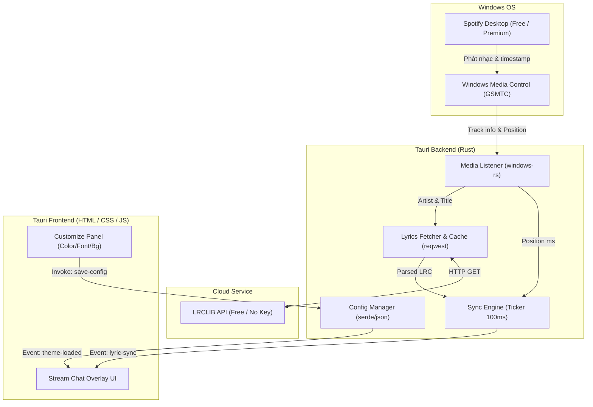

# Kế hoạch phát triển: Spotify Lyrics Overlay (Tauri + Rust)

Kế hoạch xây dựng ứng dụng overlay hiển thị lời bài hát Spotify theo thời gian thực (real-time synced lyrics), giao diện trong suốt như khung chat stream, siêu nhẹ, không cần tài khoản Spotify Premium và hoàn toàn miễn phí.

---

## 1. Kiến trúc hệ thống (System Architecture)



---

## 2. Công nghệ lựa chọn (Tech Stack)

| Thành phần | Công nghệ | Lý do chọn |
| :--- | :--- | :--- |
| **Framework** | **Tauri v2** | Nhẹ (~30-40MB RAM), hỗ trợ native transparent window và click-through trên Windows. |
| **Backend** | **Rust** | Xử lý background polling, Windows GSMTC, cache và tính toán thời gian cực nhẹ. |
| **Bắt nhạc** | **Windows GSMTC API** (`windows` crate) | Zero-setup: Không cần tài khoản Spotify Developer, không cần Client ID/Secret, không cần Spotify Premium. |
| **Nguồn Lyrics** | **LRCLIB API** | Hoàn toàn miễn phí, không cần API Key, chuẩn format `.lrc` có timestamp mili-giây. |
| **Frontend UI** | **Vanilla HTML/CSS/JS + Tailwind** | Không cần React/Vue cồng kềnh để giữ app ở mức nhẹ nhất, dễ viết animation CSS trôi lời như stream chat. |

---

## 3. Các giai đoạn triển khai (Phases & Milestones)

### Giai đoạn 1: Khởi tạo Project & Cấu hình Cửa sổ Overlay
- [x] Khởi tạo dự án Tauri v2 (Vanilla template).
- [x] Cấu hình `tauri.conf.json` cho cửa sổ overlay:
  - `transparent: true`: Nền trong suốt.
  - `alwaysOnTop: true`: Luôn nổi trên các game / ứng dụng khác.
  - `decorations: false`: Bỏ toàn bộ viền, thanh tiêu đề (titlebar).
  - `shadow: false`: Bỏ đổ bóng cửa sổ của Windows.
- [ ] Test tính năng **Click-through** (`set_ignore_cursor_events`) và phím tắt bật/tắt chế độ khóa chuột.

### Giai đoạn 2: Module Bắt bài hát & Đồng bộ Lyrics (Rust)
- [x] **Windows Media Listener:**
  - Dùng crate `windows` kết nối `GlobalSystemMediaTransportControlsSessionManager`.
  - Đọc `Title`, `Artist`, `PlaybackStatus` (Playing/Paused), và `TimelineProperties.Position` (vị trí bài hát hiện tại).
- [x] **Lyrics Fetcher & Parser:**
  - Gọi API LRCLIB `https://lrclib.net/api/get`.
  - Bộ parse file `.lrc` thành cấu trúc:
    ```rust
    struct LyricLine {
        timestamp_ms: u64,
        text: String,
    }
    ```
  - Cơ chế cache bài hát trong bộ nhớ RAM để tránh gọi API trùng lặp.
- [x] **Sync Ticker:**
  - Timer chạy nền mỗi 100ms - 200ms để emit sự kiện `lyric-tick` sang Frontend (dòng hiện tại, dòng tiếp theo, độ trễ).

### Giai đoạn 3: Thiết kế Giao diện "Stream Chat Overlay" (Frontend)
- [x] **Container kiểu Chatbox:**
  - Khung chữ trôi từ dưới lên hoặc neo ở một góc màn hình.
  - Tự động cuộn mượt (smooth auto-scroll) khi chuyển câu.
- [x] **Hiệu ứng chữ (Visual Effects):**
  - **Dòng đang hát:** Font chữ to hơn, màu nổi bật (Highlight/Accent), có hiệu ứng đổ bóng phát sáng (Glow / Text-shadow).
  - **Các dòng trước/sau:** Mờ dần (`opacity: 0.3 - 0.5`), thu nhỏ nhẹ để tập trung vào câu chính.
  - Dùng CSS transition mượt mà không gây giật lag.

### Giai đoạn 4: Hệ thống Tùy biến (Customization & Tray Icon)
- [x] **System Tray Icon (Khay hệ thống):**
  - Vì cửa sổ overlay có thể bật chế độ click-through (chuột không click vào được), bắt buộc phải có Tray Icon ở góc phải taskbar để:
    - Bật/Tắt Click-through (Khóa / Mở chuột).
    - Mở cửa sổ Cài đặt (Settings).
    - Thoát ứng dụng.
- [x] **Bảng cấu hình Settings & file `config.json`:**
  - Tùy chỉnh màu chữ thường (`text_color`).
  - Tùy chỉnh màu câu đang hát (`active_color`).
  - Độ mờ nền (`background_opacity`: từ 0% trong suốt hoàn toàn đến có nền đen mờ).
  - Font chữ (`font_family`) và cỡ chữ (`font_size`).
  - Căn lề: Trái / Giữa / Phải.

### Giai đoạn 5: Tối ưu hóa & Đóng gói (Release)
- [x] Tối ưu hóa file binary bằng cờ `lto = true`, `strip = true`, `opt-level = "z"` trong `Cargo.toml`.
- [ ] Đảm bảo ứng dụng chạy dưới 40MB RAM và < 0.2% CPU khi không đổi câu.
- [ ] Build ra 1 file `.exe` độc lập mang đi đâu cũng chạy được.

---

## 4. Các rủi ro kỹ thuật & Giải pháp (Risk & Mitigations)

1. **Bài hát không có lời trên LRCLIB:**
   - *Giải pháp:* Nếu API trả về 404, hiển thị thông báo nhẹ nhàng: `♪ Đang phát: {Tên bài hát} - {Ca sĩ}` để người dùng vẫn biết app đang nhận diện đúng bài.
2. **Độ lệch timeline giữa Windows Media và bài hát:**
   - *Giải pháp:* Thêm mục tùy chỉnh `offset_ms` (cộng/trừ 100ms - 500ms) trong Settings để người dùng tự tinh chỉnh nếu thấy lời chạy nhanh/chậm hơn nhạc.
3. **Quên cách tắt chế độ Click-through:**
   - *Giải pháp:* Gán phím tắt toàn cục (Global Hotkey, ví dụ `Ctrl + Shift + L`) để toggle click-through ngay lập tức mà không cần bấm vào Tray.

---

## Cập nhật triển khai (2026-11-21)

Các hạng mục đã đánh dấu đã có mã nguồn. Chưa build, chưa kiểm tra click-through khi chạy và chưa đo RAM/CPU; các bước đó vẫn để mở theo yêu cầu.
